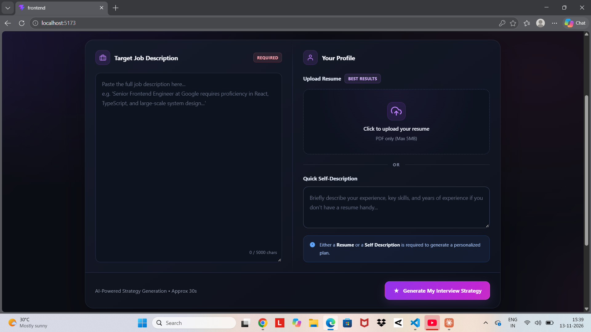
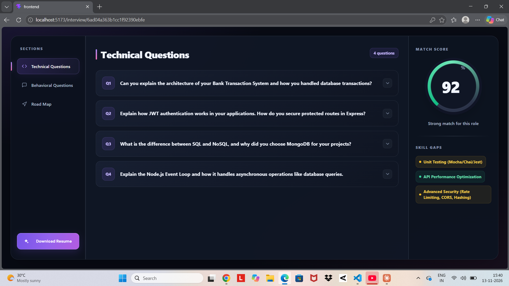
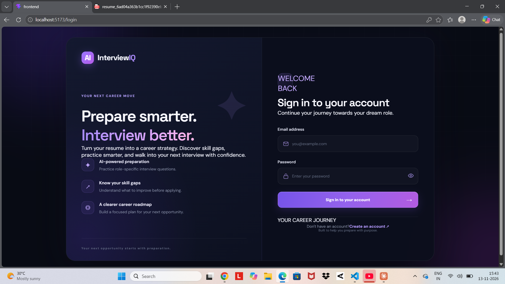
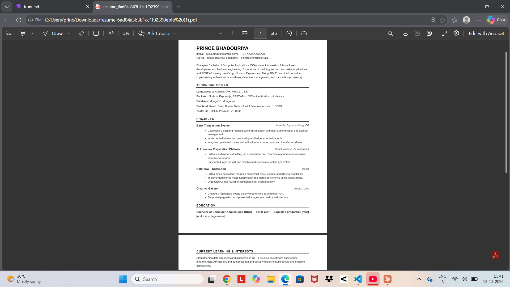
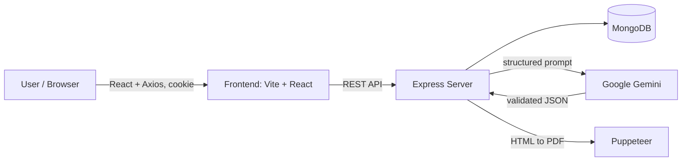

<div align="center">

# InterviewIQ

### Turn your resume into an interview strategy, powered by Google Gemini

Paste a job description, upload your resume, and get a personalised interview plan with a match score, likely questions, skill gaps and a day-wise roadmap. Then download a resume tailored to the same role.


[Live Demo](https://ai-interview-iq-theta.vercel.app) | [Report a Bug](../../issues) | [Request a Feature](../../issues)

</div>

---

## Table of Contents

- [Overview](#overview)
- [Screenshots](#screenshots)
- [Features](#features)
- [How It Works](#how-it-works)
- [Tech Stack](#tech-stack)
- [Architecture](#architecture)
- [Security and Reliability](#security-and-reliability)
- [Project Structure](#project-structure)
- [API Reference](#api-reference)
- [Environment Variables](#environment-variables)
- [Getting Started](#getting-started)
- [Deployment Notes](#deployment-notes)
- [Future Improvements](#future-improvements)
- [Author](#author)

---

## Overview

Most candidates prepare for interviews with generic question lists. InterviewIQ reads the **actual job description** and the **candidate's own profile**, finds where they match and where they do not, and builds a plan around that gap.

It is a full stack MERN application with JWT cookie authentication, structured AI output validated with Zod, and server side PDF generation.

## Screenshots

> Add your screenshots to `docs/screenshots/` and update the paths below.

| Home | Interview Report |
| --- | --- |
|  |  |

| Login | Resume PDF |
| --- | --- |
|  |  |

## Features

| | Feature | Details |
| --- | --- | --- |
| 🔐 | **Secure authentication** | Register, login and logout with a JWT in an httpOnly cookie. Logged out tokens are blacklisted. |
| 📄 | **Resume or self description** | Upload a PDF (max 5MB) or write a short description if you do not have a resume handy. |
| 🎯 | **Match score** | A 0-100 score showing how well your profile fits the job description. |
| 💬 | **Technical and behavioral questions** | Each question comes with the interviewer's intention and how to approach the answer. |
| 🧩 | **Skill gaps** | Missing skills tagged as low, medium or high severity. |
| 🗓️ | **Preparation roadmap** | A day-wise plan with a focus area and tasks for each day. |
| 📝 | **Tailored resume PDF** | An ATS friendly, single column resume generated for the target role, using only facts from your own resume. |
| 🗂️ | **Report history** | Every report is saved, so you can reopen it anytime. |

## How It Works

1. The user logs in and fills the form on the Home page (job description plus a resume PDF or a self description).
2. The backend validates the input, checks the file is a real PDF, and extracts the text from it.
3. The text is sent to Gemini with a strict JSON schema, and the response is validated with Zod.
4. The report is saved to MongoDB under the user's account and opened on its own page.
5. On request, a second Gemini call writes an HTML resume, which Puppeteer converts to a PDF in a locked down browser page.

## Tech Stack

| Layer | Technologies |
| --- | --- |
| **Frontend** | React, Vite, React Router, Axios, SCSS |
| **Backend** | Node.js, Express |
| **Database** | MongoDB with Mongoose |
| **AI** | Google Gemini (`@google/genai`) with structured JSON output |
| **PDF** | Puppeteer (generation), pdf-parse (resume text extraction) |
| **Validation** | Zod |
| **Auth and security** | JWT, bcryptjs, helmet, CORS, express-rate-limit, Multer |

## Architecture



## Security and Reliability

**Authentication**
- Passwords are hashed with bcrypt and never returned by the API (`select: false`).
- The token lives in an httpOnly cookie, so JavaScript cannot read it.
- Login gives the same error for a wrong email and a wrong password, so registered emails cannot be guessed.
- Logged out tokens go to a blacklist collection, and a TTL index removes them after 1 day (same as the JWT expiry).

**Abuse protection**
- `helmet` security headers and CORS limited to the frontend URL.
- Rate limits: 200 requests per 15 minutes per IP on the API, 20 per 15 minutes on auth routes, and 30 AI requests per hour per user.
- Request body limited to 1MB, uploads limited to 5MB.

**AI safety**
- User text is wrapped in tags and treated as data only, which protects against prompt injection.
- AI output is validated with Zod before it is saved.
- AI generated HTML is rendered with scripts and network requests blocked, so it cannot run code or reach the network while becoming a PDF.
- The resume prompt forbids inventing companies, dates, skills or numbers.

**Reliability**
- Gemini calls retry on temporary errors and fall back to the next model in the list.
- The server refuses to start if the database or the API key is missing.
- A central error handler turns Mongoose, Multer and duplicate key errors into clear messages.
- Every report query checks the owner, so a user can only read their own reports.

## Project Structure

```
Backend/
├── server.js
└── src/
    ├── app.js
    ├── config/db.js
    ├── controllers/      auth.controller.js, interview.controller.js
    ├── middlewares/      auth, error, file upload, rate limit
    ├── models/           user, interviewReport, blacklist
    ├── routes/           auth.routes.js, interview.routes.js
    ├── services/         ai.service.js
    └── utils/            asyncHandler.js

Frontend/
└── src/
    ├── main.jsx, App.jsx, app.routes.jsx
    ├── features/
    │   ├── auth/         context, hooks, services, pages (Login, Register), Protected
    │   └── interview/    context, hooks, services, pages (Home, Interview)
    └── pages/NotFound.jsx
```

## API Reference

| Method | Endpoint | Description | Access |
| --- | --- | --- | --- |
| `POST` | `/api/auth/register` | Register a new user | Public |
| `POST` | `/api/auth/login` | Log in with email and password | Public |
| `GET` | `/api/auth/logout` | Clear the cookie and blacklist the token | Public |
| `GET` | `/api/auth/get-me` | Get the logged in user | Private |
| `POST` | `/api/interview/` | Generate a report (multipart: `resume`, `jobDescription`, `selfDescription`) | Private |
| `GET` | `/api/interview/` | List all reports of the user | Private |
| `GET` | `/api/interview/report/:interviewId` | Get one report | Private |
| `POST` | `/api/interview/resume/pdf/:interviewReportId` | Download a tailored resume PDF | Private |
| `GET` | `/health` | Health check | Public |

## Environment Variables

**Backend** (`Backend/.env`)

| Variable | Required | Description |
| --- | --- | --- |
| `MONGO_URI` | Yes | MongoDB connection string |
| `JWT_SECRET` | Yes | Long random string used to sign tokens |
| `GOOGLE_GENAI_API_KEY` | Yes | Gemini API key |
| `CLIENT_URL` | Yes | Frontend URL for CORS (default `http://localhost:5173`) |
| `PORT` | No | Server port (default `3000`) |
| `NODE_ENV` | No | Set to `production` when deployed |
| `GEMINI_MODELS` | No | Comma separated model list, tried in order |
| `USE_GOOGLE_DNS` | No | Set to `true` if your network fails MongoDB Atlas SRV lookups |

**Frontend** (`Frontend/.env`)

| Variable | Required | Description |
| --- | --- | --- |
| `VITE_API_URL` | Yes | Backend URL (for example `http://localhost:3000`) |

> **Note:** The backend runs on a free plan, so the first request after a period of inactivity can take up to a minute while the server wakes up.

## Getting Started

**Prerequisites:** Node.js 18 or newer, a MongoDB database (local or Atlas), and a Gemini API key.

```bash
# 1. Clone the repository
git clone https://github.com/Coder-prince26/Ai-Interview-IQ.git
cd  Ai-Interview-IQ

# 2. Start the backend
cd Backend
npm install
# create Backend/.env using the table above
node server.js

# 3. Start the frontend (in a new terminal)
cd Frontend
npm install
# create Frontend/.env using the table above
npm run dev
```

Open `http://localhost:5173` in your browser.

## Deployment Notes

- Set `NODE_ENV=production` on the backend. The cookie then uses `secure: true` and `sameSite: none`, which is required when the frontend and backend are on different domains.
- Set `CLIENT_URL` on the backend to your deployed frontend URL, and `VITE_API_URL` on the frontend to your deployed backend URL.
- Puppeteer needs Chrome on the server, so choose a host where it can be installed.
- `trust proxy` is already enabled, so rate limiting sees the real client IP behind a platform proxy.

## Future Improvements

- Verify the token before adding it to the blacklist on logout
- Use a Redis store for rate limiting when running more than one server instance
- Support scanned (image only) resumes with OCR
- Let users re-generate a single section of a report
- Add automated tests for the API routes

## Author

**Prince Singh**

- GitHub: [@Coder-prince26](https://github.com/Coder-prince26)


---

<div align="center">

If this project helped you, consider giving it a ⭐

</div>